

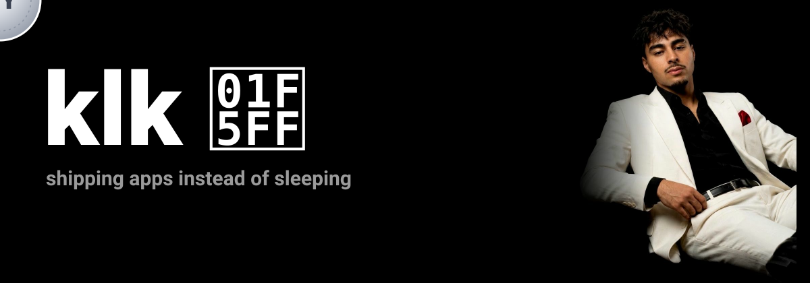

**Arch-nemesis:** procrastination 😤 (currently winning) &nbsp;·&nbsp; **1 app live, 6 cooking, 0 finished on time** 🍳 bugs are just features with commitment issues

## Apps (some of them even work, klk)

<table>
<tr><td width="50%" align="center" valign="top"><a href="https://apps.apple.com/app/id6833664311">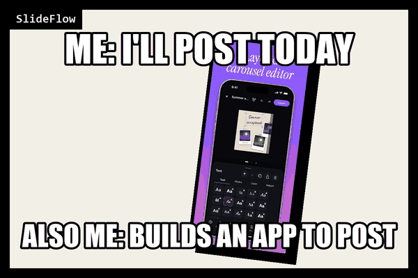</a> <b><a href="https://apps.apple.com/app/id6833664311">SlideFlow</a></b> Instagram carousels that swipe nice. Templates in, editable layers out. Ta' fácil.  </td><td width="50%" align="center" valign="top">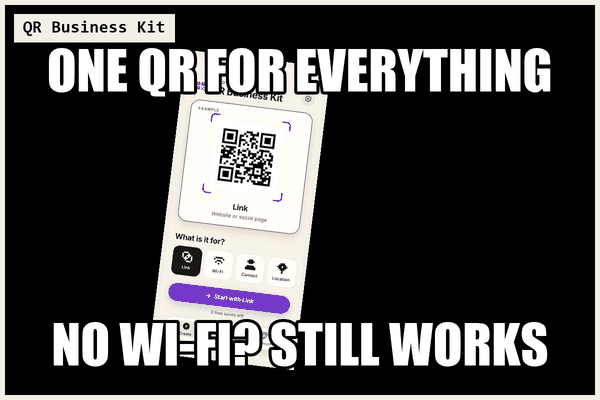 <b>QR Business Kit</b> QR codes for links, Wi-Fi, contacts and menus. Works offline. Sin internet, sin drama.  </td></tr>
<tr><td width="50%" align="center" valign="top">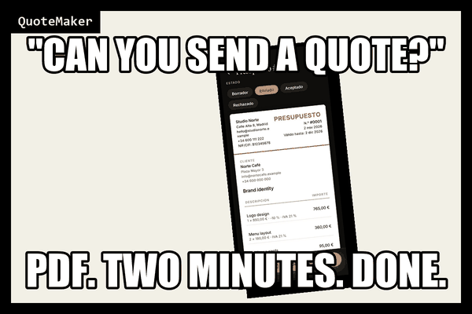 <b>QuoteMaker</b> A proper PDF quote from your phone in under two minutes. Tu cliente: «wow».  </td><td width="50%" align="center" valign="top">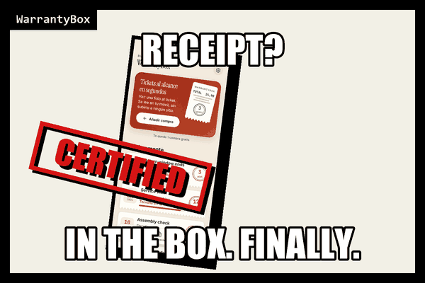 <b>WarrantyBox</b> Receipts and warranty dates in one box. Snap, forget, find later. Cero papelitos.  </td></tr>
<tr><td width="50%" align="center" valign="top">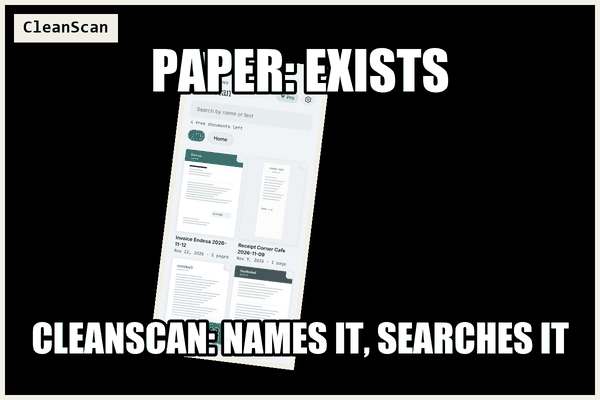 <b>CleanScan</b> Scans paper, names it, searches the words inside. Adiós, scan_final_FINAL2.pdf.  </td><td width="50%" align="center" valign="top">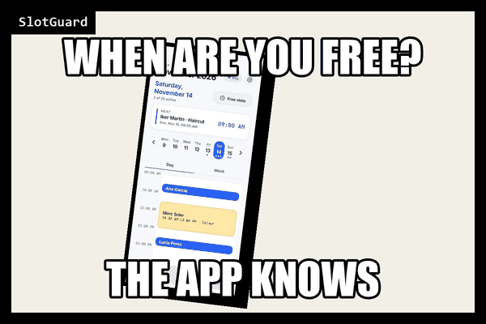 <b>SlotGuard</b> Appointment book for the self-employed: your day and your free slots. Nadie cae sin avisar.  </td></tr>
<tr><td width="50%" align="center" valign="top">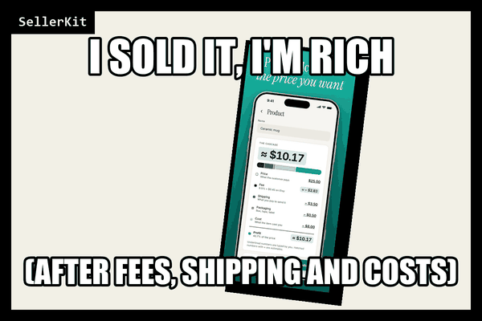 <b>SellerKit</b> What you really keep from a sale after fees, shipping and costs. La verdad duele.  </td><td width="50%" align="center" valign="top"> <b>Numevia</b> How much you can spend today, not just your balance. Dime cuánto, no cuánto hay.  </td></tr>
<tr><td width="50%" align="center" valign="top"> <b>PsyFlow</b> Mood tracking plus a supportive AI chat. Not therapy, just a mood log with good vibes.  </td><td width="50%" align="center" valign="top"> <b>FadeSpec</b> Your haircut on the record: photo, price, barber, next-cut date. Evidence for the barber.  </td></tr>
<tr><td width="50%" align="center" valign="top"> <b>Cerca</b> Share your location without being tracked all day. Sharing ends on its own. Sin stalkeo.  </td><td width="50%" align="center" valign="top"> <b>AniFlow</b> A diary for the anime you watch: ratings, lists, stats. Un episodio más (mentira).  </td></tr>
</table>

## Side quests (not abandoned, just resting their eyes)

<table>
<tr><td width="50%" align="center" valign="top">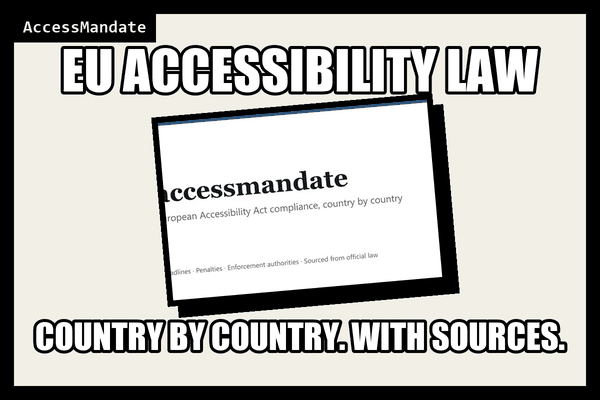 <b>AccessMandate</b> EU accessibility law, country by country, with official sources. Fun? No. Útil? Sí.  </td><td width="50%" align="center" valign="top"> <b>KitwiseStudio</b> Spreadsheet templates and printables, like a tracker for freelancers. Excel, pero con cariño.  </td></tr>
</table>

## Bots & experiments (not financial advice, barely advice)

<table>
<tr><td width="50%" align="center" valign="top">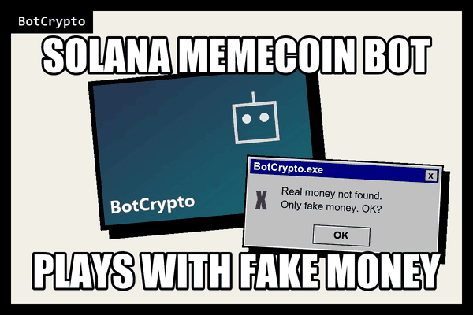 <b>BotCrypto</b> Solana memecoin trading bot. Fake money only. Cero drama.  </td><td width="50%" align="center" valign="top">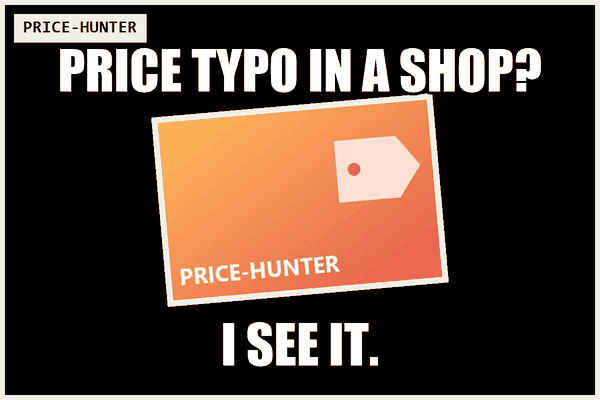 <b>PRICE-HUNTER</b> Hunts price mistakes and big bargains in online shops. Ojo de águila.  </td></tr>
<tr><td width="50%" align="center" valign="top"> <b><a href="https://github.com/nidalYH/Smart-Money-Social-Sentiment">Smart-Money-Social-Sentiment</a></b> Big-wallet crypto moves vs. social media mood. Las ballenas se mueven, el timeline opina.  </td><td width="50%"></td></tr>
</table>

if you scrolled this far, go touch grass 🗿

