# Hola 👋, soy Nidal

I build small, polished apps.

🌐 [nidalyehia.com](https://nidalyehia.com)

## Projects

<table>
<tr>
<td width="280" valign="top">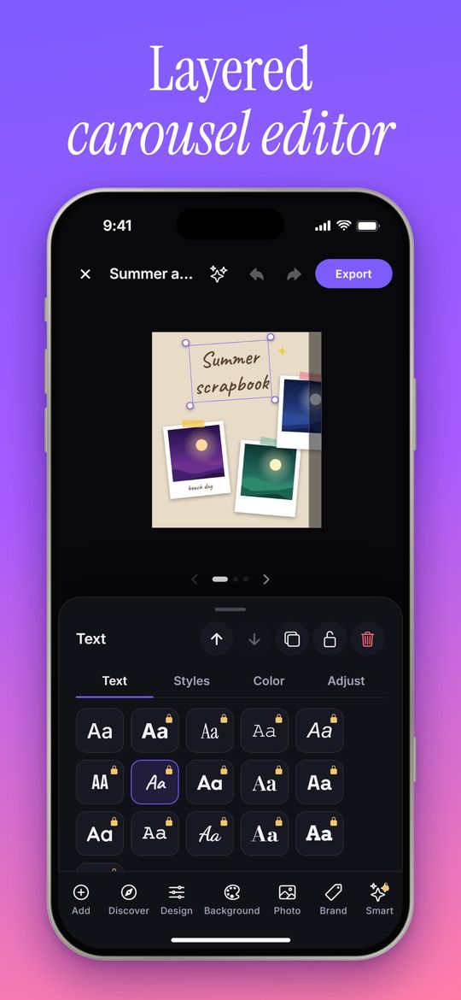</td>
<td valign="top"><b><a href="https://apps.apple.com/app/id6833664311">SlideFlow</a></b> Design swipeable carousels for Instagram and other social networks. Start from a template, edit every layer, and export when you're done.</td>
</tr>
<tr>
<td width="280" valign="top">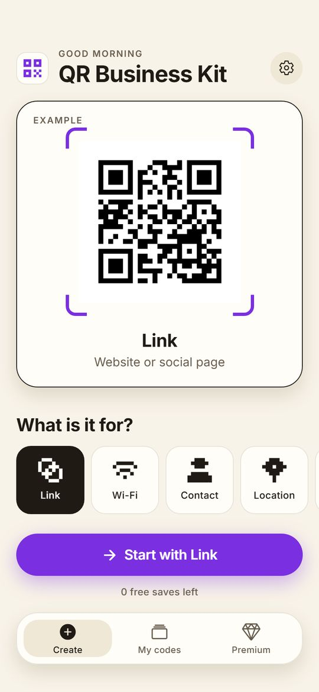</td>
<td valign="top"><b>QR Business Kit</b> Make QR codes for your business in seconds: links, Wi-Fi, contact cards, menus and more. Works without an internet connection.</td>
</tr>
<tr>
<td width="280" valign="top">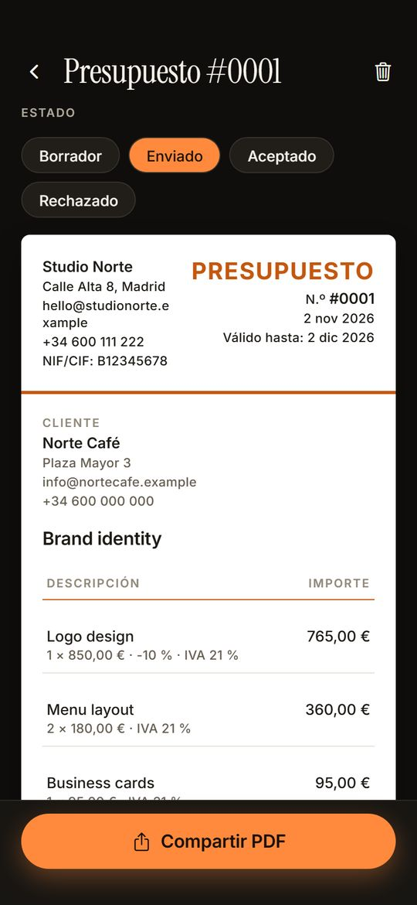</td>
<td valign="top"><b>QuoteMaker</b> Create professional quotes on your phone and send them as a PDF in under two minutes. Made for freelancers and small businesses.</td>
</tr>
<tr>
<td width="280" valign="top">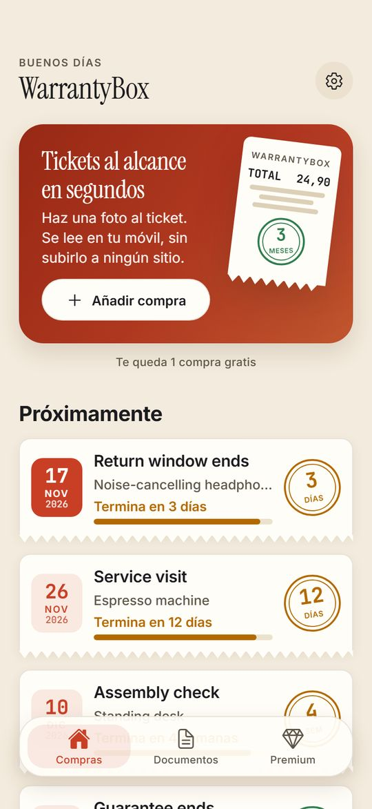</td>
<td valign="top"><b>WarrantyBox</b> Keep your receipts, invoices and warranty dates in one place. Snap a photo of a purchase and find it again whenever you need it.</td>
</tr>
<tr>
<td width="280" valign="top">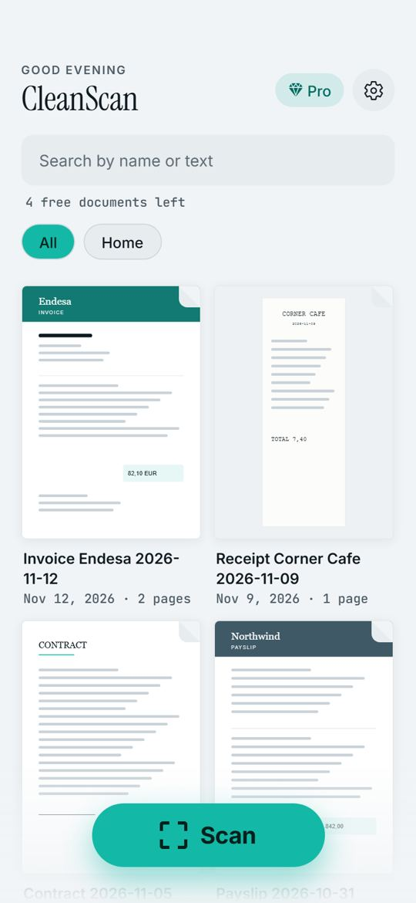</td>
<td valign="top"><b>CleanScan</b> Scan paper documents, name them automatically and search for the words inside. Files stay small enough to send by email.</td>
</tr>
<tr>
<td width="280" valign="top">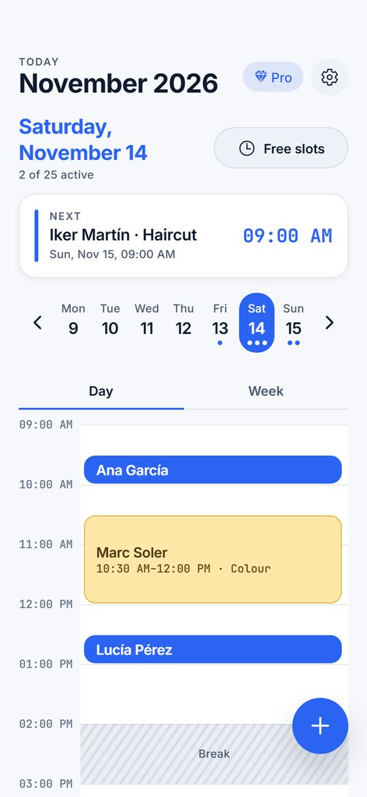</td>
<td valign="top"><b>SlotGuard</b> A simple appointment book for people who work for themselves. See your day, your free slots, and send clients a clear message.</td>
</tr>
<tr>
<td width="280" valign="top">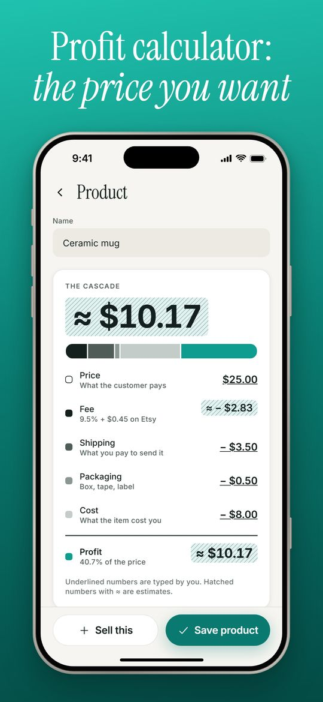</td>
<td valign="top"><b>SellerKit</b> Find out how much you really keep from every sale after marketplace fees, shipping and costs. Also keeps a log of what you sold.</td>
</tr>
<tr>
<td width="280" valign="top">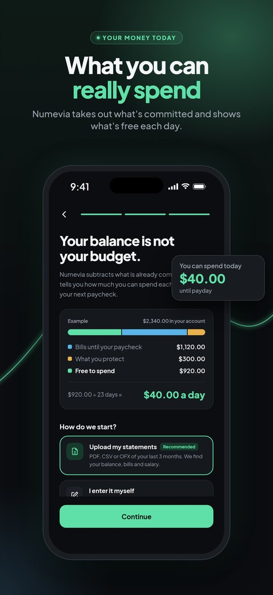</td>
<td valign="top"><b>Numevia</b> A personal-finance app that shows how much you can actually spend today, not just your balance. Log an expense by typing, speaking or scanning.</td>
</tr>
<tr>
<td width="280" valign="top"></td>
<td valign="top"><b>PsyFlow</b> A mental wellbeing app that combines emotional tracking with a supportive AI chat.</td>
</tr>
<tr>
<td width="280" valign="top">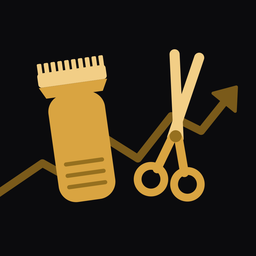</td>
<td valign="top"><b>FadeSpec</b> Your haircut, on the record. Log every cut with a photo, price and barber, see when you're due for the next one, and remember exactly how to ask for it.</td>
</tr>
<tr>
<td width="280" valign="top">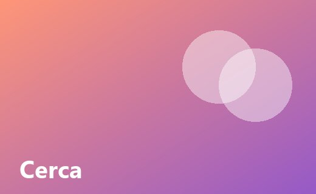</td>
<td valign="top"><b>Cerca</b> Share your location with a partner or group without being tracked all day. Sharing always ends on its own, and you can stop it with one tap.</td>
</tr>
<tr>
<td width="280" valign="top"></td>
<td valign="top"><b>AniFlow</b> A diary for the anime you watch: rate shows, build your own lists, discover new ones and see your stats.</td>
</tr>
<tr>
<td width="280" valign="top">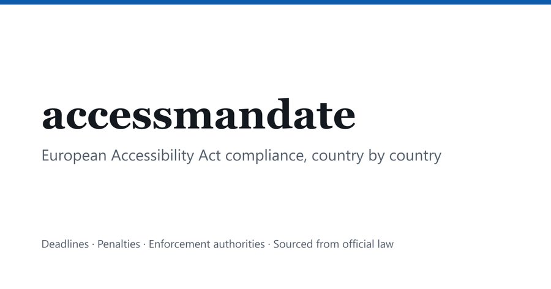</td>
<td valign="top"><b>AccessMandate</b> Country-by-country guide to EU accessibility law: deadlines, penalties and who enforces the rules, with official sources.</td>
</tr>
<tr>
<td width="280" valign="top">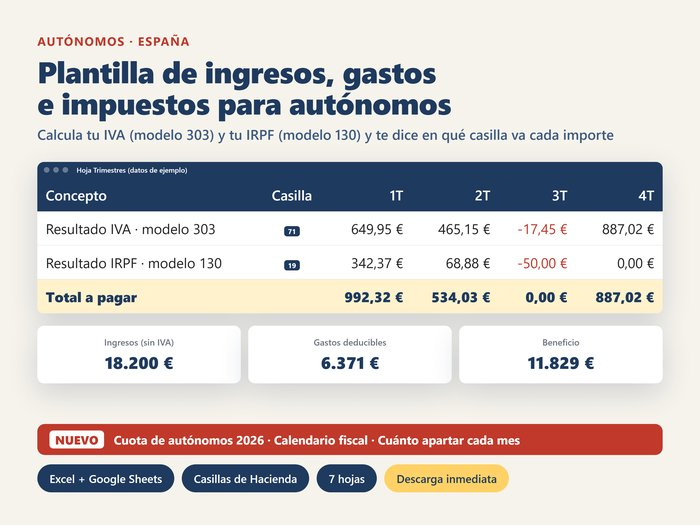</td>
<td valign="top"><b>KitwiseStudio</b> Ready-made spreadsheet templates and printables, such as an income, expense and tax tracker for freelancers.</td>
</tr>
<tr>
<td width="280" valign="top"></td>
<td valign="top"><b>BotCrypto</b> An experiment: a trading bot for Solana memecoins that only practises with simulated money.</td>
</tr>
<tr>
<td width="280" valign="top">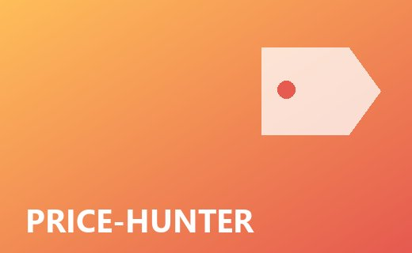</td>
<td valign="top"><b>PRICE-HUNTER</b> An experiment: a bot that looks for price mistakes and big bargains on online shops.</td>
</tr>
<tr>
<td width="280" valign="top"></td>
<td valign="top"><b><a href="https://github.com/nidalYH/Smart-Money-Social-Sentiment">Smart-Money-Social-Sentiment</a></b> An experiment that compares big-wallet crypto activity with social media sentiment.</td>
</tr>
</table>
